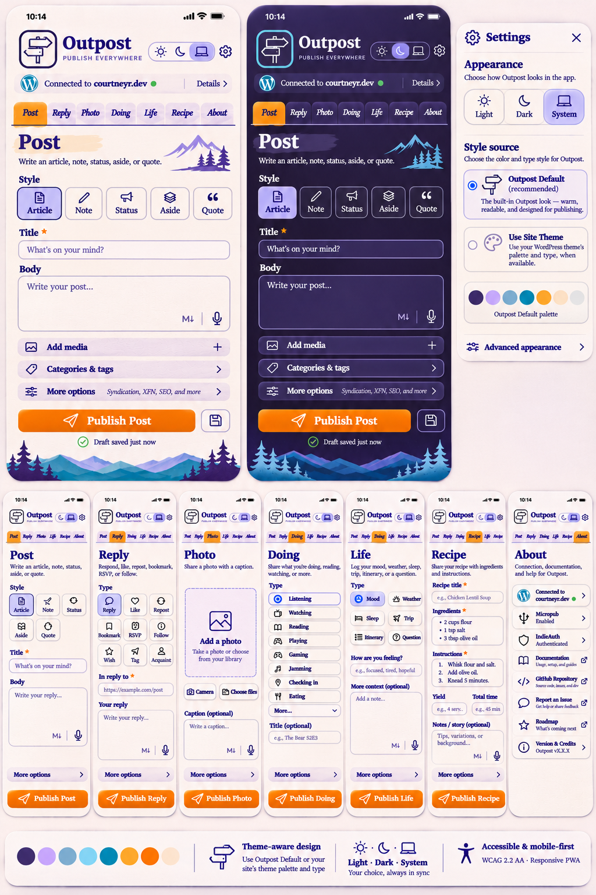

# Outpost PWA design handoff

This directory preserves the final theme-adaptive outline mockup and the revised Claude Code implementation brief. It changes no production application code.

## Design reference

Read the [complete implementation brief](implementation-brief.md) before implementing the image. Preview the [canonical-derived signpost outline](outpost-signpost-outline.svg).

The PNG is the downloaded final generated image titled "Theme Adaptive Outpost UI Mockup" in [Improve Outpost PWA UI](https://chatgpt.com/c/6aec9ec4-6664-83ea-ba10-32826873e408). It follows the earlier filled-logo revision and accompanies the request for an outline on a theme-provided color. The cached conversation preview omits this generated attachment; the original conversation's image viewer supplies it. The downloaded bytes remain unchanged.

| File property | Value |
| --- | --- |
| Dimensions | 1024 × 1536 pixels |
| Size | 2,081,285 bytes |
| SHA-256 | `d50e11039fe45b3000e59a1bbf174c15ec854ccbc3b1ee06207b7eb03678c9a6` |
| Repository base inspected | `d79277f67000199245bfcfe344684b7d0aa167cd` |
| Handoff branch | `feature/pwa-ui-design-handoff-2026-11-07` |

## Approved direction and implementation clarifications

- Outpost Default ships the illustrated paper/violet/orange design. Use Site Theme is an optional palette and typography source. Both sources support independent Light, Dark, and System choices.
- The in-app signpost is a transparent, token-colored outline derived from the canonical SVG. The installed PWA retains its fixed manifest and Apple touch icons.
- About presents connection information, authentication, help, documentation, repository links, and version information. It has no profile editor or publishing action.
- The complete inventory has seven destinations, five Post styles, eleven Reply types, fifteen Doing types, six Life types, photo/gallery flows, and structured recipes. Generated thumbnails shorten or omit some labels and fields. Preserve the source inventory.
- The new-user default is Outpost Default + System. Preserving existing users' prior Site Theme behavior on upgrade is a migration choice in this brief, not a claim that this migration already exists.

The current repository says the theme owns every paint value. The implementation must document the authorized amendment for selectable sources while retaining semantic tokens, B6, parity, shell isolation, and public opt-outs. This artifact commit doesn't change those runtime rules or claim the new behavior exists.

## Home launcher revision, 2026-11-08

The Home launcher, footer Home link, Default start screen preference, and four-section About extend this design rather than replace it. The [implementation brief](implementation-brief.md) carries the merged requirements in sections 3, 6, 7, 8, 10, and 12.

- Design reference: [home-launcher-mockup.webp](home-launcher-mockup.webp), a generated image like the first mockup.
- Review of that mockup against every shipped tab, with twelve proposed improvements: [mockup-review-2026-11-08.md](mockup-review-2026-11-08.md).
- Required views as captures of the running build: [evidence-home/](evidence-home/).
- Decision record: [session-pwa-ui-home.md](../../decisions/session-pwa-ui-home.md). Verification: the Home section of [verification.md](verification.md).

## Canonical SVG reconciliation

The source is [outpost-icon.svg at the inspected commit](https://github.com/courtneyr-dev/outpost/blob/d79277f67000199245bfcfe344684b7d0aa167cd/assets/icons/outpost-icon.svg), Git blob `3f3a5c598558b3c3fea02fc7c12cd3e48bd0d1ae`.

The derivative retains the 256×256 viewBox, pole rectangle at x=121/y=44/width=14/height=164, foot at x=97/y=200/width=62/height=12, and both board path strings without coordinate changes. It removes the two background/frame rectangles and replaces the artwork's fills with a 5-unit `currentColor` stroke. A mask hides pole lines behind the original board and foot silhouettes. The mask's black/white values control visibility, not palette color. Use instance-unique mask IDs when inlining repeated marks.

The generated PNG remains a visual reference; its icon rendering doesn't establish canonical geometry. Use the derivative and source comparison for implementation. The derivative is a design asset in this directory, not a replacement for `assets/icons/outpost-icon.svg`.

## Limits of the image

The image doesn't prove accessibility, actual connection state, publishing behavior, responsive behavior, or completed implementation. Its `vX.X.X`, connected address, authentication labels, saved-state message, and roadmap row are illustrative. Read runtime data and use real destinations. Its small text, decorative gradients, rounded logo frame, and omitted variants aren't literal requirements.

The orange button with white text needs a measured contrast check and may need a different text/fill pair. The exact raster color values and generated font shapes aren't approved token specifications. Keep readable typography and test final resolved pairs. These are implementation review requirements under [color contrast](https://specification.website/spec/accessibility/color-contrast/), [form labels](https://specification.website/spec/accessibility/form-labels/), [touch targets](https://specification.website/spec/accessibility/touch-target-size/), and [focus not obscured](https://specification.website/spec/accessibility/focus-not-obscured/).

The mockup contains no working controls. No UI conformance, device test, payload test, or CI pass is claimed by saving it. The source review covers repository instructions, the FY theming decision, the six publishing mode components and About, tab/config code, shell, appearance classes/controllers, token files, package scripts, contribution rules, and CI/docs workflow definitions. It isn't an exhaustive repository audit or live-site test. Earlier claims about a separate site theme's bridge remain hypotheses until that integration is inspected.

## Implementation handoff

Paste [implementation-brief.md](implementation-brief.md) into Claude Code from a checkout of this branch. It contains the complete prompt, acceptance criteria, test commands, release boundaries, and ChatGPT review-artifact protocol. During implementation, the review files named there record decisions, evidence, feedback, and resolutions. They don't exist yet because no implementation review has run.
