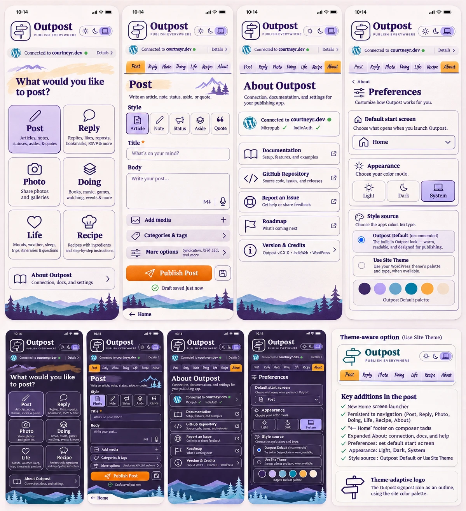

# Home launcher mockup review, 2026-11-08

This review compares the Home launcher mockup with Outpost 1.0.24's shipped tabs and with the Home implementation on branch `pwa/home-launcher`. It lists where this branch follows the mockup, where it deliberately departs, and what each other tab could improve next. Evidence: the 1.0.24 captures in [evidence/](evidence/) and this branch's captures in [evidence-home/](evidence-home/). All captures use local wp-env and synthetic data.

| File property | Value |
| --- | --- |
| File | `home-launcher-mockup.webp` |
| Dimensions | 1199 × 1312 pixels |
| SHA-256 | `2a9e7b0964dedef3732f0bcddd95aa20ce917f7af8df0055688b709d97ffdfe8` |

Like the first mockup, it's a generated image. Its labels, connection dot, `vX.X.X`, and "Draft saved just now" are illustrative, and its pixels aren't token values.

## Required mockups, as real captures

The brief asked for six mockups. Each is now a capture of the running build, which is stronger evidence than a drawing: it shows real copy, real tokens, and the real connection state.

| Required view | Capture | axe (WCAG 2.2 AA tags) |
| --- | --- | --- |
| Home, Light, Outpost Default | [home-light-390.png](evidence-home/home-light-390.png); [320 px](evidence-home/home-light-320.png); [1280 px](evidence-home/home-light-1280.png) | 0 violations |
| Home, Dark, Outpost Default | [home-dark-390.png](evidence-home/home-dark-390.png) | 0 |
| Home, Use Site Theme | [light](evidence-home/home-site-light-390.png), [dark](evidence-home/home-site-dark-390.png) (Twenty Twenty-Five palette) | 0 |
| Composer with the Home footer link | [post-light-390.png](evidence-home/post-light-390.png), [post-dark-390.png](evidence-home/post-dark-390.png) | 0 |
| About: Connection and documentation | [about-light-390.png](evidence-home/about-light-390.png), [dark](evidence-home/about-dark-390.png), [Use Site Theme](evidence-home/about-site-light-390.png) | 0 |
| About: Preferences with Default start screen | in each About capture; [Preferences sheet](evidence-home/preferences-sheet-light-390.png) | 0 |
| Home with an unsent draft | [home-draft-light-390.png](evidence-home/home-draft-light-390.png) | 0 |

Raw results: [home-axe-results.json](evidence-home/home-axe-results.json). An automated scan doesn't establish conformance.

## Where the build departs from the mockup, and why

| # | Mockup | Built | Reason |
| --- | --- | --- | --- |
| 1 | "PUBLISH EVERYWHERE" under the wordmark | The connected site's host | An all-caps tagline is a claim, not information. The host tells you where a post goes. |
| 2 | "Connected to courtneyr.dev ●" strip on every screen | A connection line on Home only | The composer header already shows the host, and About has the full connection card. A green dot alone is color-only (WCAG 1.4.1), so the line uses the same glyph and text states as About. |
| 3 | All seven tabs squeezed into 390 px in small italic | The scrolling tab strip with an overflow cue | Seven labels at that size fall below a readable size. The brief kept the scrolling strip. |
| 4 | House icon inside the start-screen select | A native `<select>` with text options | Native controls get platform pickers on iOS and Android and read correctly in screen readers. |
| 5 | Palette swatch row under Style source | Not built | Swatches with no labels carry meaning by color alone. Proposal 8 below is a labeled version for Use Site Theme. |
| 6 | Roadmap row in About | Not built | The repository has no maintained roadmap page or milestones to link to. |
| 7 | "Outpost vX.X.X · IndieWeb · WordPress" | The running version and the credits from `readme.txt` | The brief bans placeholder versions. |
| 8 | Micropub ✓ and IndieAuth ✓ | Runtime states, including "Not checked yet" | The brief bans hard-coded success states. |
| 9 | Settings reached through About only | The gear opens a Preferences sheet; About › Preferences shows the same panel | The approved header sheet stays; both copies read and write one state. |
| 10 | "Choose the app's colors tna type." | "Choose where Outpost gets its colors and fonts." | A typo in the generated image. |

## Improvements made on other tabs in this branch

| # | Tab | Change | Evidence |
| --- | --- | --- | --- |
| D1 | Post | **Sign out** moved from beside the publish button to About › Connection, as "Sign out of this device" with a line saying it removes drafts and the preferences copy. | 1.0.24 [Post](evidence/outpost-light-390-note.png) vs [Post](evidence-home/post-light-390.png) and [About](evidence-home/about-light-390.png) |
| D2 | All | The header's gear and its sheet are named **Preferences**, one name for one concept. | [Preferences sheet](evidence-home/preferences-sheet-light-390.png) |
| D3 | About | Four sections: Connection, Preferences, Help and documentation, Project. Adds Sharing and shortcuts, version and credits, and Reset preferences. | [About](evidence-home/about-light-390.png) |
| D4 | About, sheet | The three preference titles share one style, and inside About they sit below the "Preferences" heading instead of outranking it. | same |

## Proposed next improvements

Ranked by how much of the screen or the task they affect. Each keeps native controls, every variant, and the token contract. P1 to P6 are done on branch `pwa/compact-composer`, stacked on this one; [P1 to P6 as built](#p1-to-p6-as-built) records what changed from the proposal text and why.

| # | Tab | Observation | Proposal | Status |
| --- | --- | --- | --- | --- |
| P1 | Doing | 15 type tiles in two columns fill about 560 px before the first field ([capture](evidence/outpost-light-390-listen.png)). | Show the type as a compact radio grid in three columns from 360 px, or the six most-used types plus a "More types" disclosure that keeps the selected one visible. The brief allows a compact picker when every option stays discoverable. | Done: wrapping tiles, 576 → 268 px at 390 |
| P2 | Reply | 11 type tiles take six rows ([capture](evidence/outpost-light-390-reply.png)). | Same treatment as P1. | Done: wrapping tiles, 436 → 218 px at 390 |
| P3 | Post | Five style tiles take three rows ([capture](evidence-home/post-light-390.png)); the mockup fits them in one row with icons. | One row of five icon-and-label radio tiles at 360 px and up, wrapping below that. | Done: one row from 360 px, 226 → 82 px at 390 |
| P4 | All composing tabs | With an empty form the publish button is a dashed outline that reads as missing, not as waiting for input. | A full-width primary button at the form's end, with the variant-specific label ("Post article" says more than the mockup's "Publish Post") and a one-line hint naming the missing required field. | Done in all six composing tabs |
| P5 | Header | At 390 px the Light / Dark / System switch wraps under the wordmark and pushes every tab down about 50 px. | Keep wordmark, switch, and gear on one row from 375 px: signpost, wordmark, three 44 px segments, and a 44 px gear need about 330 px of the 343 px available. | Done: one row from 375 px, 119 → 70 px |
| P6 | Header | The selected appearance segment uses the same orange fill as the selected tab and the publish button, so three orange controls compete on one screen. | Use the chip-active tokens (violet tint) for the selected segment, as the mockup does, and keep orange for the publish action. | Done: new segment tokens, not chip-active |
| P7 | Photo | The photo picker is an unstyled native "Choose Files" control ([capture](evidence/outpost-light-390-photo.png)). | An "Add photos" button with a camera icon that opens the same native input, plus the selected count in text. | Open |
| P8 | Preferences | Use Site Theme is a blind choice: you see the result only after picking it. | A labeled preview row under Use Site Theme: background, text, and accent swatches each with its name and the resolved value as text. | Open |
| P9 | Doing | Rating is a free-text field labeled "1–5". | A five-option radio group with a "No rating" choice. | Open |
| P10 | Post, Photo, Doing | Venue name and the OpenStreetMap disclosure sit in the main flow of every kind. | Group them in a "Location" row beside More options, as the mockup groups Categories and tags. | Open |
| P11 | Post | Three lines of Markdown help under every body field. | One line ("Markdown and HTML pass through; your site renders them") with the detail in the docs. | Open |
| P12 | Install | The manifest has no `shortcuts`, so a long-press on the Android icon offers nothing. | Manifest shortcuts for New post, New reply, and New photo, pointing at `/post/?mode=…`, which the share-target dispatcher already routes. | Open |

P1 to P4 change the most screen space per tap. P5 and P6 touch every screen. P12 is the smallest change.

## P1 to P6 as built

Branch `pwa/compact-composer`, cut from this branch at `3c64836`. Captures are local wp-env with synthetic data: before on this branch, after on `pwa/compact-composer`, each at 320 and 390 px in light and dark for all six composing tabs, in [evidence-compact/](evidence-compact/). axe-core 4.13.0 with the WCAG 2.0 to 2.2 A/AA tags found 0 violations in all 48 views ([before](evidence-compact/before-axe-results.json), [after](evidence-compact/after-axe-results.json)). No view scrolls sideways. An automated scan doesn't establish conformance.

| Measure (Outpost Default, light) | Before | After |
| --- | --- | --- |
| Doing type picker at 390 px / 320 px | 576 / 576 px | 268 / 418 px |
| Reply type picker at 390 px / 320 px | 436 / 436 px | 218 / 318 px |
| Post style picker at 390 px / 320 px | 226 / 226 px | 82 / 146 px (one row from 360 px) |
| Header at 390 px / 375 px / 320 px | 119 / 119 / 119 px | 70 / 70 / 119 px |
| Publish button width at 390 px | 147 to 155 px of 318 px | 318 of 318 px |

Compare, for example, Doing [before](evidence-compact/before-listen-light-390.png) and [after](evidence-compact/after-listen-light-390.png), Post in dark [before](evidence-compact/before-note-dark-390.png) and [after](evidence-compact/after-note-dark-390.png), and Reply at 320 px [before](evidence-compact/before-reply-light-320.png) and [after](evidence-compact/after-reply-light-320.png).

### Where the build differs from the proposal text

- **P1, P2: wrapping tiles, not three fixed columns or a disclosure.** At 360 px the form is 288 px wide, so three columns leave 92 px per tile. A 20 px radio plus padding leaves about 56 px for the label, and "Acquisition" and "Exercise" don't fit without breaking mid-word. Content-sized tiles that wrap like words keep all 15 and all 11 types visible in one radio group, so the selected type is always on screen and arrow keys move through every type. A "More types" disclosure would hide radios that arrow keys can still select. Compact tiles are also `border-box`: the 44 px minimum is now the whole tile, where the old tiles measured 44 px of content plus padding and border (about 60 px).
- **P3: the native radio covers each tile.** Each style is still an `<input type="radio">` in one fieldset. It's transparent and covers its tile, as in the header's appearance switch, so the whole tile is the hit target. The icon is `aria-hidden` and the label text names the radio. The selected tile has a 2 px ink ring and a bold label, so the state doesn't rely on color, and forced-colors mode outlines it in `Highlight`.
- **P5: the header had 311 px at 375 px, not 343 px.** `.outpost-composer` already pads 16 px on each side and the header added another 16 px. The header now adds only the safe-area inset (0 on a portrait phone, the notch width in landscape), which gives the host 97 px at 375 px for the 82 px `localhost:8890` needs. Below 375 px the header still wraps to two rows.
- **P6: new tokens, because chip-active is orange.** `--outpost-chip-active-bg` is an alias of `--outpost-chip-bg-pressed`, which is the action fill (`#fb8500`) in Outpost Default and the resolver's `$fill` under Use Site Theme. Using it would have changed nothing on screen. The selected segment paints from two new component tokens, `--outpost-segment-bg-selected` and `--outpost-segment-fg-selected`. `Outpost_Token_Resolver::component_tokens()` derives the background as a 14% tint of the field toward `accent_2` and backs it off toward the field until the text color reaches 4.5:1 on it. Outpost Default gets `#e8e6f1` with `#241c4a` (12.70:1) and `#3b3463` with `#f7f4ff` (10.41:1). `TokenFileParityTest` pins the file values to the derivation and checks the label at 4.5:1 and the 2 px ring at 3:1.

### P4 details

Every composing tab (Post, Reply, Doing, Photo, Life, Recipe) ends with `PublishButton` (`pwa/src/components/publish-button.tsx`): the secondary actions (Show preview, More options), then a one-line hint, then the full-width button with the variant's label. The hint names the empty required fields by short names ("Still needed: Title and Body.", "Still needed: Recipe title, Ingredients, and Instructions.") and is the button's `aria-describedby` only while it has text. It isn't a live region, because it changes as people type. The disabled button keeps its disabled tokens but loses the dashed outline. The rules for what's required are unchanged.

### Tests

`pwa/src/components/modes/compact-composer.test.tsx` (every type visible and none behind a disclosure, tile names and hidden icons, the publish button last in each form, the hint text per tab and variant), `pwa/src/lib/publish-hint.test.ts`, `pwa/src/styles/structure.test.ts` (static checks on the P5 and P6 rules, which happy-dom can't lay out), and the segment cases in `tests/theming/TokenResolverTest.php` and `TokenFileParityTest.php`.

Not done: a device or screen-reader check, and captures under Use Site Theme (the resolver tests cover a pale-accent and a low-contrast-ink palette).
