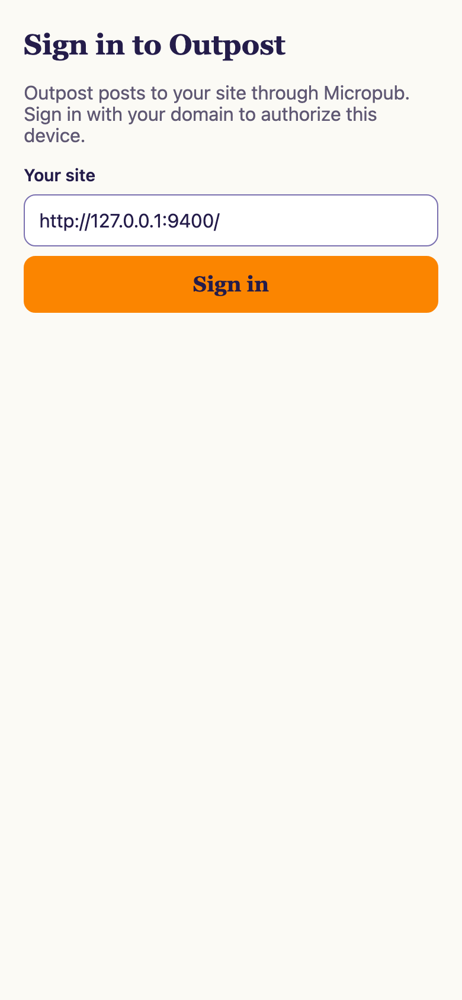
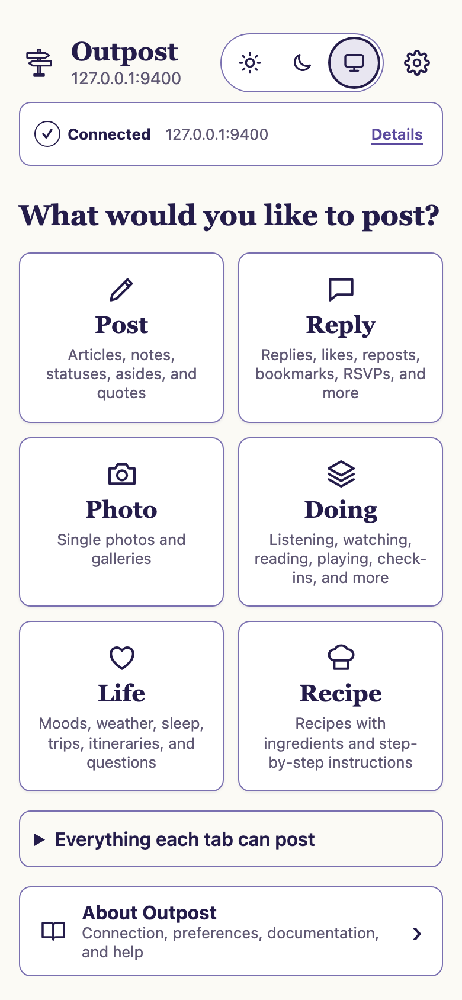
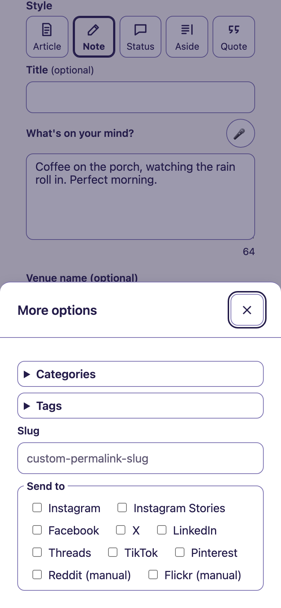
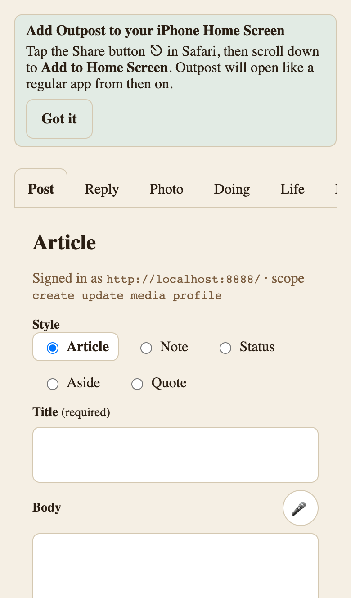

Your first session with Outpost: sign in, post a note from your phone, and install the composer to your home screen. This assumes you've finished [Installation](/outpost/installation/) — IndieAuth, Micropub, and Outpost all active.

## 1. Open the composer on your phone

On your phone's browser, visit:

```text
https://your-site.example/post/
```

Expected result: the Outpost composer loads — a mobile-first posting screen, not your theme's regular page layout. If you instead see a setup page naming a missing plugin, activate that plugin and reload (see [Troubleshooting](/outpost/troubleshooting/)).



## 2. Sign in with IndieAuth

The composer asks you to sign in with IndieAuth — your WordPress site is the identity provider, so you sign in to your own site rather than a third-party service. Approve the sign-in when your site prompts you.

Expected result: the composer shows its posting modes and you're ready to write.

## 3. Post a note

1. Outpost opens on **Home**, with a card for each kind of post. Tap **Post**. (**← Home** at the bottom of any tab brings you back.) Its first choice is the post style, set to **Article** unless your site admin changed the default (see [Settings](/outpost/settings/)). Choose **Note**.

   

2. Type a short post. After you pause, "Draft saved" appears under the form: the text is kept on this device until you post it.
3. If you use syndication destinations, chips for each configured destination appear enabled by default. Tap a chip to turn it off for this post.
4. Tap **Post note**, the full-width button at the end of the form. Until the post has everything it needs, the button is unavailable and the line above it names what's missing, for example "Still needed: Text."



Expected result: a success message with a link to the new post on your site. Open it to confirm the note published.

If you get "Posted, but the server did not return a link. Check your site to confirm it published," check your site before you post again. With Micropub 2.5.0 or older, a rejected post can look like a success; update Micropub to 2.5.1 or newer (see [Troubleshooting](/outpost/troubleshooting/#the-composer-said-it-posted-but-theres-no-post)).

## 4. Install to your home screen

The composer is a PWA, so you can install it like an app:

- **iOS (Safari):** tap the Share button, then "Add to Home Screen."
- **Android (Chrome):** accept the install banner, or open the browser menu and choose "Add to Home screen" / "Install app."

Expected result: an Outpost icon on your home screen that opens straight to Outpost's Home screen, or to the start screen you pick in step 5.



## 5. Pick how the composer looks

Tap **Preferences** (the gear at the top right) to choose three things for yourself. The same choices are in **About › Preferences**.

- **Default start screen:** what opens when you launch Outpost. **Home** is the default; pick **Post**, **Reply**, or another tab to skip it.
- **Style source:** **Outpost Default** (Outpost's own design) or **Use Site Theme** (your theme's colors and fonts).
- **Appearance:** **Light**, **Dark**, or **System**, which follows your device. The three buttons next to the gear switch this too.

Each person who posts has their own choices, and they follow you to every device you sign in on. [Settings → Appearance](/outpost/settings/#appearance) has the details.

## First-run notes

- **Drafts:** each tab keeps its unsent text on your device, so a reload or a fresh sign-in doesn't lose it. When you come back, the composer says "Draft restored from this device. Nothing posts until you post it." Photos themselves aren't kept; add them again and their alt text and captions fill back in. Signing out clears drafts.
- **Offline posting:** if you post without a connection, the post queues on your device and submits when you're back online. A queue indicator shows pending posts with retry and dismiss controls.
- **Companions round out the kind-shaped modes:** all composer tabs — the Doing group (Listen, Watch, Read, Play, Game, Jam, Checkin, Eat, Drink, Exercise, Craft, Event, Review, Video, Audio) and the Life group (Mood, Weather, Sleep, Trip, Itinerary, Question) included — are always visible. With the Post Kinds for IndieWeb in Block Themes companion plugin active, every entry is classified and rendered as its proper post kind on your site and the media "Look it up" search works; without it they still publish, but as generic notes.
- **Encryption key notice:** if you plan to store API keys or connect external accounts, wp-admin may show a notice about configuring an Outpost encryption key. Sensitive settings can't be saved until the key is set up — see [Settings](/outpost/settings/).
- **Managed hosting:** some managed WordPress hosts strip the authorization header from requests, which can break sign-in or lookups. See [Troubleshooting](/outpost/troubleshooting/#sign-in-or-lookups-fail-on-managed-hosting) if posting fails after a successful sign-in.

## Where to go next

- [Settings](/outpost/settings/) — composer defaults, API keys, appearance, and connections.
- [Common tasks](/outpost/common-tasks/) — replies, bookmarklets, the share sheet, and more.
