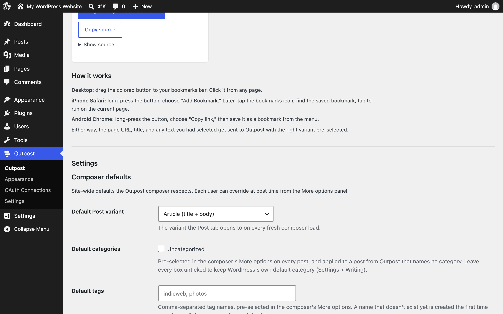

Every user-visible Outpost setting, where to find it in wp-admin, and when to change it.

Navigation: everything lives under one **Outpost** menu in the wp-admin sidebar — the main page (the composer link, bookmarklets, phone-install steps, and the Composer defaults form), then the **Settings**, **Appearance**, and **OAuth Connections** submenus. The one exception is the iOS Shortcut bridge, which sits under WordPress's own **Settings → Outpost iOS Shortcut**.

## Composer defaults

**Location:** wp-admin → Outpost (the first Outpost menu), "Settings" section at the bottom of the page. Requires the Administrator-level `manage_options` capability.

These are site-wide defaults; each user can override them at post time from the composer's More options panel.

| Setting | What it does | Default |
| --- | --- | --- |
| Default Post variant | Which variant the Post tab opens to on every fresh composer load. Choices: Article (title + body), Note (auto-format from content length), Status, Aside, Quote. | Article |
| Default categories | Checkboxes, one per category. The ticked ones come pre-selected in the composer's More options on every post, and a post from Outpost that names no category gets them instead of WordPress's own default (Settings → Writing → Default Post Category). Untick everything to keep WordPress's default. | None |
| Default tags | Comma-separated tag names, pre-selected in the composer's More options. A name that doesn't exist yet is created the first time a post uses it. | None |
| Bridgy auto-suggest | When a Reply or Doing target URL's host matches a known silo, pre-check the matching Bridgy publish target. Bridgy is a bridge service that syndicates posts to networks like Mastodon and Bluesky. Turn off if you prefer explicit syndication only. | On |
| Auto Post-Format inference | Sets the WordPress post format automatically from the post's content signals (likes become link format, photos become image or gallery, and so on). Works only while the Post Formats for Block Themes plugin is active; [How Outpost shapes a post](/outpost/how-outpost-shapes-a-post/#post-formats) has the full table. Turn off if you prefer manual format selection. | On |



The screenshot predates the Default categories and Default tags fields, which sit between Default Post variant and Bridgy auto-suggest.

## Outpost Settings (multi-tab page)

**Location:** wp-admin → Outpost → Settings. Requires `manage_options`.

### API Keys tab

The default tab. Syndication destinations and integrations (newsletter services and similar) register their credential fields here — the exact fields you see depend on which destination adapters are available in your version.

Sensitive fields are stored encrypted. Until Outpost has an encryption key, this tab shows "Outpost encryption key is not configured. Sensitive settings cannot be saved until the key is set." and no form.

Set the key before you open this tab:

1. Generate 32 random bytes as base64 on any computer with PHP:

   ```bash
   php -r "echo base64_encode(random_bytes(32));"
   ```

2. Add this line to `wp-config.php`, above `/* That's all, stop editing! */`, with your string in place of the placeholder:

   ```php
   define( 'OUTPOST_ENCRYPTION_KEY', base64_decode( 'paste-your-base64-string-here' ) );
   ```

   Keep the `base64_decode()`: the constant must hold the 32 raw bytes. If it holds the base64 text instead, Outpost ignores it and shows a notice saying so.

3. Reload the API Keys tab. The form appears.

If you can't edit `wp-config.php`, connect any account under **OAuth Connections** first. Saving that connection makes Outpost generate a key and store it in the database, after which this tab shows its form. An admin notice then recommends moving the key to `wp-config.php`, because a database backup that includes the key also unlocks the credentials stored with it. The developer note at [concepts/encryption-key.md](https://github.com/courtneyr-dev/outpost/blob/main/docs/concepts/encryption-key.md) has the details.

If a tab shows "No settings registered for this tab yet," no destination has added fields to it.

## Appearance

You can change appearance in two places, and both change the same per-user settings:

- In the composer: tap the gear button at the top right to open **Preferences**, go to **About › Preferences**, or use the Light / Dark / System buttons next to the gear.
- In wp-admin: Outpost (first menu) → **Appearance**. Available to anyone who can edit posts.

Two independent choices:

- **Style source** — **Outpost Default** is the built-in design: warm paper, violet ink, and orange actions, with a violet dark scheme. **Use Site Theme** uses your active theme's colors and fonts instead. Outpost checks the theme's text, button, link, border, and focus colors against WCAG AA contrast and adjusts any that fall short. If your theme has no dark style variation, Dark keeps Outpost's dark surfaces and uses your theme's accent and fonts.
- **Appearance** — **Light** and **Dark** always show that scheme. **System** follows your phone or computer setting and switches while Outpost is open.

New people start on Outpost Default and System. If you used Outpost before version 1.0.24, you stay on Use Site Theme, which is what you saw before, until you pick another style source.

A choice you make while offline applies on that device right away, and Outpost saves it to your site the next time it connects. Preferences says when a choice is saved only on the device. **Reset preferences** returns to Home, System, and Outpost Default.

The composer's Preferences also hold the **Default start screen**: the screen a normal launch opens to. Choices: Home, Post, Reply, Photo, Doing, Life, Recipe, or About; Home is the default. It's per person and follows you to every device. Opening Outpost from the share sheet, a bookmarklet, or the iOS Shortcut still goes to the tab that content belongs in. It's separate from the site-wide **Default Post variant**, which picks the style the Post tab starts on.

The wp-admin page also has **Token overrides**: set an individual color or font for Light or Dark. Overrides apply under either style source.

## OAuth Connections

**Location:** wp-admin → Outpost (first menu) → OAuth Connections. Requires `manage_options`.

The "Outpost OAuth Connections" page lists six providers: Notion, Oura, WHOOP, Polar Flow, Ride With GPS, and Ravelry, with a status column and Connect and Disconnect actions. Connecting sends you through that provider's sign-in; tokens are stored per user, encrypted. Use Disconnect to revoke a connection.

Tokens aren't refreshed automatically in 1.0.24. If a connected service stops returning data, disconnect and connect it again. [Supported services](/outpost/supported-services/#pull-recent-activity-from-a-connected-account) lists what each connection is used for.

## iOS Shortcut

**Location:** wp-admin → Settings → Outpost iOS Shortcut. Requires `manage_options`.

iOS Safari doesn't support the Web Share Target API, so iOS users install a small Apple Shortcut that sends share-sheet content to Outpost. The "Outpost iOS Shortcut Bridge" page walks through it:

1. **Install the Shortcut:** in 1.0.24 this step reads "iCloud Shortcut link is not yet published. Check back after the next plugin release." The ready-made Shortcut isn't available yet. Build your own instead with the steps in [Share to Outpost from your phone](/outpost/common-tasks/#iphone-and-ipad); it needs no token.
2. **Site URL, user name, and password:** the ready-made Shortcut signs in with a WordPress application password. **Create Shortcut password** makes one for you through WordPress and shows it once; copy it into the Shortcut. That password works only for Outpost's Shortcut endpoint. **Replace** stops the old password at once; **Revoke** deletes it. You can also see and revoke it under Users → Profile → Application Passwords. Application passwords need HTTPS (or a local development site); the page says so when they're unavailable.

Before 1.0.27 the page issued an Outpost token instead. Updating to 1.0.27 deletes those tokens, so a Shortcut set up with one needs a new password.

## Settings that don't exist

- **The composer address.** The composer is always at `/post` on your site. No setting changes it.
